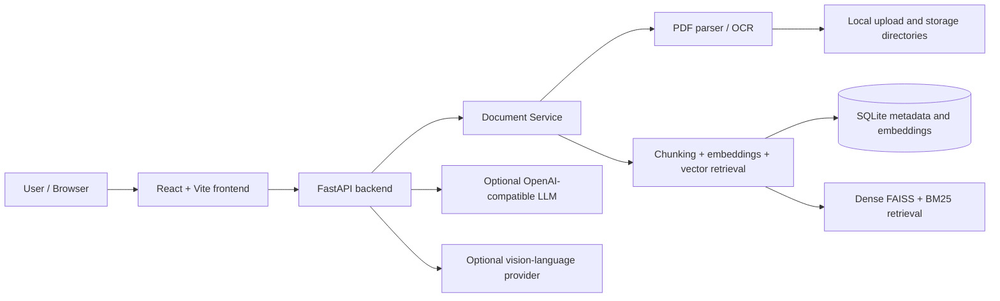

# DocuMind AI — Multimodal Document Intelligence Platform

DocuMind AI is a document intelligence application for PDF upload, OCR-aware extraction, chunking, semantic retrieval, grounded answers, cross-document comparison, and document management. The core implementation is CPU-friendly and works without paid APIs, while optional LLM and vision providers can be enabled through configuration.

## Architecture



## Technology stack

- Frontend: React, TypeScript, Vite, Tailwind-inspired custom CSS
- Backend: FastAPI, Pydantic, SQLAlchemy
- Document processing: PyMuPDF, pytesseract, OpenCV, Pillow
- Retrieval: sentence-transformers, FAISS dense search, BM25 keyword search, reciprocal-rank fusion
- Storage: SQLite and local filesystem
- Optional generation: OpenAI-compatible text and vision providers; disabled by default
- Testing: pytest, FastAPI TestClient, reportlab-generated PDFs

## Installation

### 1. Python environment

```powershell
cd C:\Users\dell\Desktop\284D\IMP\Project3
python -m venv .venv
.\.venv\Scripts\Activate.ps1
python -m pip install --upgrade pip
pip install -r backend\requirements.txt
```

### 2. Frontend

```powershell
cd frontend
npm install
```

### 3. Environment file

Copy `.env.example` to `.env` and adjust values as needed. The default mode
works without LLM or vision API credentials.

```powershell
Copy-Item .env.example .env
```

## Windows and PowerShell setup

On Windows, use PowerShell for local setup and run the backend from the project root:

```powershell
cd C:\Users\dell\Desktop\284D\IMP\Project3
$env:PYTHONPATH = 'backend'
.\.venv\Scripts\python.exe -m uvicorn main:app --app-dir backend --host 127.0.0.1 --port 8000
```

Start the frontend separately:

```powershell
cd C:\Users\dell\Desktop\284D\IMP\Project3\frontend
npm run dev -- --host 0.0.0.0
```

## Tesseract installation on Windows

Install Tesseract OCR from the official project or a package manager and ensure the executable is available on PATH.

```powershell
where.exe tesseract
```

If Tesseract is not found, install it and then set `TESSERACT_CMD` in `.env` if needed.

## Model downloads and first-run behavior

The default embedding model is `sentence-transformers/all-MiniLM-L6-v2`. The
model loads the first time an upload needs embeddings; its weights may need to
download from Hugging Face. Upload processing requires the embedding model to
be available, while optional LLM and vision providers remain disabled unless
configured.

The app does not require paid providers to perform text extraction, embedding,
retrieval, or extractive Q&A. Enabling the optional hosted providers sends
selected evidence or a rendered page image to that provider.

## Environment variables

The project uses these configuration variables:

- `DATABASE_URL` — SQLite database path
- `UPLOAD_DIR` — directory for uploaded PDFs
- `STORAGE_DIR` — local rendered page and artifact storage
- `VECTOR_STORE_PATH` — vector index metadata directory
- `MAX_UPLOAD_SIZE` — maximum upload in bytes
- `MAX_PDF_PAGES` — maximum pages allowed per document
- `CHUNK_SIZE` / `CHUNK_OVERLAP` — chunking window in characters
- `OCR_ENABLED` — enable OCR fallback
- `TESSERACT_CMD` — override Tesseract executable path if necessary
- `EMBEDDING_MODEL` — embedding model name
- `EMBEDDING_MODEL_REVISION` — model branch, tag, or commit revision used for embedding compatibility
- `RETRIEVAL_MODE` — `dense` or `hybrid` (dense + BM25 via reciprocal-rank fusion)
- `DENSE_RELEVANCE_THRESHOLD` — minimum cosine similarity before returning evidence
- `LLM_PROVIDER` — `disabled`, `openai`, or `openai-compatible`
- `LLM_API_KEY` — optional secret
- `LLM_API_BASE_URL`, `LLM_API_TIMEOUT`, `LLM_MAX_CONTEXT_CHARS`, `LLM_TEMPERATURE` — optional text-generation settings
- `LLM_MODEL` — model name
- `VISION_PROVIDER` — `disabled`, `openai`, or `openai-compatible`
- `VISION_API_KEY` — optional secret
- `VISION_API_BASE_URL`, `VISION_API_TIMEOUT`, `VISION_MODEL` — optional visual-analysis settings
- `CORS_ORIGINS` — comma-separated browser origins; `*` is the development default

Never commit real credentials or secrets to the repository.

## Running the app

### Backend

```powershell
cd C:\Users\dell\Desktop\284D\IMP\Project3
$env:PYTHONPATH = 'backend'
.\.venv\Scripts\python.exe -m uvicorn main:app --app-dir backend --host 127.0.0.1 --port 8000
```

### Frontend

```powershell
cd C:\Users\dell\Desktop\284D\IMP\Project3\frontend
npm run dev -- --host 0.0.0.0
```

Open the frontend at http://localhost:5173 and the backend at http://localhost:8000.

## API endpoints

The backend exposes these routes:

- `GET /api/health`
- `POST /api/documents/upload`
- `GET /api/documents`
- `GET /api/documents/{document_id}`
- `DELETE /api/documents/{document_id}`
- `GET /api/documents/{document_id}/pages/{page_number}`
- `GET /api/documents/{document_id}/pages/{page_number}/image`
- `POST /api/documents/{document_id}/pages/{page_number}/analyze-visual`
- `POST /api/documents/{document_id}/summarize`
- `POST /api/chat/query`
- `POST /api/chat/compare`
- `GET /api/chat/history`
- `GET /api/search`
- `GET /api/models/status`
- `GET /api/settings`

## OCR pipeline

The document ingestion flow is:

1. PDF validation and size checks
2. Native text extraction using PyMuPDF
3. OCR fallback if the page contains little or no extractable text
4. Page-level metadata capture including extraction method and confidence
5. Chunking and embedding generation for retrieval

OCR is not forced on every page. It is used when the page appears too sparse for reliable native extraction. When Tesseract is unavailable, the pipeline degrades gracefully and records the failure state without crashing the app.

## RAG architecture

The ingestion path extracts page text and tables where available, splits text
into overlapping chunks, embeds those chunks once, and persists normalized
vectors with the configured model name in SQLite. Searches reuse compatible
stored vectors; stale or absent vectors are rebuilt if the configured model
changes.

Search supports dense FAISS cosine similarity or hybrid dense + BM25 retrieval.
Hybrid mode uses reciprocal-rank fusion (RRF, k=60), avoiding direct addition of
scores with different scales. Search responses expose dense similarity,
keyword score, and final ranking score separately. Scores are ranking signals,
not probabilities of answer correctness.

Question answering is extractive by default. When an OpenAI-compatible LLM is
configured, the backend supplies bounded retrieved passages as untrusted
evidence and accepts only citations that map to actual retrieved chunk IDs.
Provider failures are surfaced and use a clearly labeled extractive fallback.
When no evidence clears the relevance threshold, the response says that the
documents do not provide enough evidence.

Vision analysis is a separate, explicit action. It renders only the selected
page and sends that image to a configured compatible vision model. It is
disabled by default; OCR and extracted text alone are not presented as visual
understanding.

## Multimodal limitations

This implementation distinguishes between:

- text-based document understanding (native PDF text + OCR)
- visual interpretation (preview + optional vision-provider integration)

Charts, diagrams, and scanned layouts are only interpreted when a configured vision model is available. Without it, the system still works with extracted text and page metadata, but it will not claim to understand visual semantics beyond the available text evidence.

## Evaluation methodology

The evaluation suite in `tests/test_document_pipeline.py` covers:

- native PDF extraction
- malformed PDF validation
- page preservation and retrieval
- document deletion
- chat answer generation
- retrieval path for user queries

This is a lightweight, reproducible evaluation suite using generated PDFs and API-level tests rather than paid external services.

## Testing

```powershell
cd C:\Users\dell\Desktop\284D\IMP\Project3
$env:PYTHONPATH = 'backend'
.\.venv\Scripts\python.exe -m pytest -q tests/test_document_pipeline.py
```

Frontend production build:

```powershell
cd C:\Users\dell\Desktop\284D\IMP\Project3\frontend
npm run build
```

Retrieval evaluation (requires the configured embedding model):

```powershell
cd C:\Users\dell\Desktop\284D\IMP\Project3
$env:PYTHONPATH = 'backend'
.\.venv\Scripts\python.exe evaluation\run_retrieval.py
```

The benchmark dataset, computed metrics, and methodology are described in
[docs/EVALUATION.md](./docs/EVALUATION.md). Architecture and implementation
details are in [docs/ARCHITECTURE.md](./docs/ARCHITECTURE.md), and verified
pre-upgrade findings are recorded in [docs/IMPROVEMENT_AUDIT.md](./docs/IMPROVEMENT_AUDIT.md).

## Known limitations

- OCR quality depends on Tesseract installation and page quality
- Complex table reconstruction is approximate rather than guaranteed perfect
- Hybrid retrieval and local embeddings are a small-corpus prototype; each query currently builds an in-memory FAISS index from persisted vectors.
- RRF retrieval scores are not calibrated confidence values. The included synthetic benchmark is small and must not be treated as a general quality claim.
- Text and vision provider compatibility depends on the chosen endpoint and model supporting the OpenAI-compatible API shape.
- Vision analysis is optional and sends the selected rendered page to the configured provider; no automatic chart/table reasoning occurs without it.
- Authentication, request rate limits, production CORS, and deployment hardening remain necessary before internet-facing use.

## Future improvements

- advanced layout-aware table extraction
- better page-to-text coordinate preservation
- cross-document comparison summaries with stronger evidence reasoning
- secure cloud storage and vector persistence enhancements
- richer dashboard analytics and audit logs

## Final note

This project is a working, evidence-grounded document intelligence app with CPU-friendly defaults, retrieval, citations, and a documented OCR path. It is intentionally designed to work without paid APIs while supporting optional provider integrations when configured.
